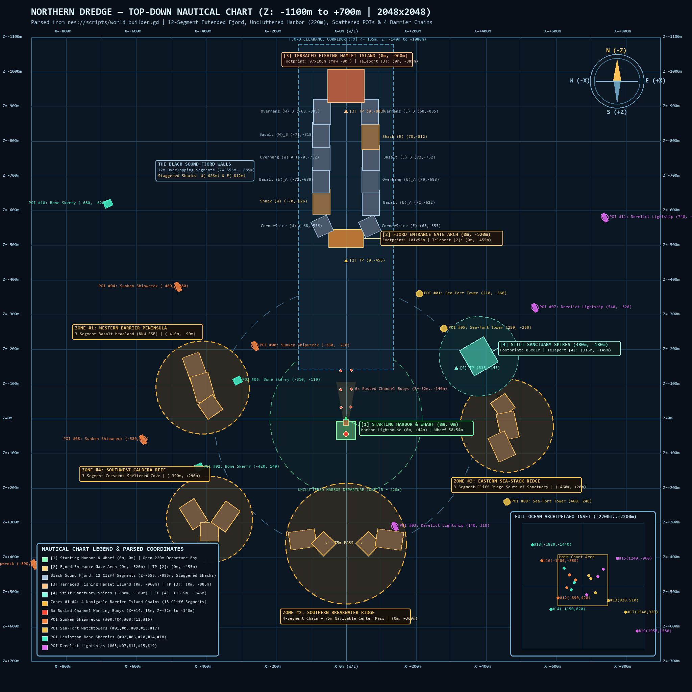

# Northern Dredge

An atmospheric Lovecraftian maritime fishing and exploration game targeting **Godot 4.7** (Forward+ Vulkan renderer).

Navigate a lone iron fishing trawler through fog-choked Nordic archipelagos, treacherous basalt canyons, bioluminescent abyssal waters, and forgotten coastal ruins while managing searchlight stealth and hull integrity against lurking horrors of the deep.

---

## Top-Down Nautical Map Overview

The world map layout is parsed directly from [`scripts/world_builder.gd`](scripts/world_builder.gd) and visualized in high resolution via [`world_map_overview.png`](world_map_overview.png):



### Key Locations & Landmarks

- **`[1]` Starting Harbor & Wharf (`0m, 0m`)**: Sheltered timber pier and 22m harbor lighthouse with rotating 350m dual volumetric beam shafts, warm dock post lanterns, and 6 rusted channel warning buoys (`Z = -32m` to `-140m`) guiding vessels out of the uncluttered 220m departure bay.
- **`[2]` Fjord Entrance Gate Arch (`0m, -520m`)**: Colossal weathered stone archway spanning 101m across the northern canyon entrance, illuminated by an overhead `AreaLight3D` ceiling wash, warm lantern beacons, and dangling iron cages.
- **The Black Sound Fjord Walls (`Z = -555m` to `-885m`)**: 12 continuous, overlapping basalt and overhang cliff segments flanking the narrow sea canyon (`X = ±68..72m`), featuring two staggered cliffside watch-shacks (West at `Z = -626m` and East at `Z = -812m`).
- **`[3]` Terraced Fishing Hamlet Island (`0m, -960m`)**: Multi-tiered timber fishing hamlet perched inside the northern fjord basin, illuminated by rectangular `AreaLight3D` window facades and pier lights that reflect across the rolling waves.
- **`[4]` Stilt-Sanctuary Spires (`+380m, -180m`)**: Triple-spire sanctuary rising out of the eastern shoals with warm beacon lights and timber catwalks.
- **4 Navigable Barrier Island Chains**:
  - **Zone #1 — Western Barrier Peninsula (`-410m, -90m`)**: 3-segment curved basalt headland running NNW–SSE.
  - **Zone #2 — Southern Breakwater Ridge (`0m, +360m`)**: 4-segment jagged barrier island chain with a **75m navigable center pass** marked by lantern beacons.
  - **Zone #3 — Eastern Sea-Stack Ridge (`+460m, +20m`)**: 3-segment basalt cliff ridge south of the Stilt-Sanctuary.
  - **Zone #4 — Southwest Caldera Reef (`-390m, +290m`)**: 3-segment crescent enclosing a sheltered fishing cove.
- **Grounded Maritime POIs**: 20 exploration hotspots distributed across coastal reefs and deep abyssal trenches, including Foundered Steamer Wrecks, Stilt Watchtowers, Leviathan Bone Skerries, and Derelict Lightships.

---

## Next-Gen Lighting & Visual Pipeline

- **Rectangular `AreaLight3D` Emitters**: Powered by a version-safe helper ([`scripts/lighting_utils.gd`](scripts/lighting_utils.gd)) that queries `ClassDB.class_exists("AreaLight3D")` (Godot 4.7+) with automatic graceful fallback to `OmniLight3D` / `SpotLight3D` on older engine builds.
- **Real-Time Global Illumination**:
  - **SDFGI**: 6-cascade Signed Distance Field Global Illumination (`0.4m` cell size, occlusion, and 75% Y-scale).
  - **SSIL & SSAO**: Screen-Space Indirect Lighting and Screen-Space Ambient Occlusion providing rich bounce into rock alcoves and under timber boardwalks.
- **Screen-Space Reflections (SSR)**: Dynamic 64-step reflections across realistic wave normals.
- **Shadowed Volumetric Fog**: Forward-scattering fog god-rays (`anisotropy = 0.68`, `gi_inject = 1.25`) with PCSS soft shadows (`shadow_blur = 1.5`) on searchlights, archways, and lighthouses.
- **ACES Filmic Tonemapping**: High dynamic range color preservation without clipping bright lanterns or bioluminescence to flat white.

---

## Controls & Teleport Hotkeys

| Input | Action |
| :--- | :--- |
| **`W` / `S`** | Throttle Forward / Reverse |
| **`A` / `D`** | Rudder Port / Starboard |
| **`L`** | Toggle Bow Searchlight (Blazing vs. Running Dark stealth) |
| **`F`** | Unlimber Sea Rod (First-Person Fishing) / Stow Rod (Navigation Helm) |
| **`TAB`** | Open / Close Dredge Ledger & Catch Log |
| **`F9` / `P`** | Toggle Peaceful Mode (Threats Ignore Player) |
| **`[1]`** | Instant Teleport: **Starting Harbor Dock** (`0m, 0m`) |
| **`[2]`** | Instant Teleport: **Fjord Entrance Gate** (`0m, -455m`, facing `-Z`) |
| **`[3]`** | Instant Teleport: **Terraced Fishing Hamlet** (`0m, -885m`, facing `-Z`) |
| **`[4]`** | Instant Teleport: **Stilt-Sanctuary Spires** (`+315m, -145m`, facing `060° NE`) |

---

## Tools & Pipeline Utilities

- **[`tools/generate_world_map_png.py`](tools/generate_world_map_png.py)**: Headless Python script that parses `scripts/world_builder.gd` and renders the 2048×2048 nautical chart (`world_map_overview.png`).
- **[`tools/blender_batch_import_meshy.py`](tools/blender_batch_import_meshy.py)**: Headless Blender 5.4.0 asset pipeline that processes raw 3D models, decimates geometry, attaches -8.5m basalt foundation skirts, and exports binary glTF (`.glb`) with contact sheets.
- **[`tools/mcp_capture_frame.gd`](tools/mcp_capture_frame.gd)**: Direct CLI/MCP in-game camera capture tool for 4K screenshot verification across navigation presets (`helm`, `first_person`, `fishing`, `fjord_gate`, `terraced_hamlet`, `stilt_sanctuary`).

---

## Development & Codebase Guidelines

All scripts in this repository strictly adhere to [`AGENTS.md`](AGENTS.md):
- Explicit static typing throughout all GDScript files (`var x: float`, `func f() -> void`).
- Zero Godot 3.x legacy syntax (Godot 4.x signals, callables, and properties only).
- Code-based signal connections only (no `.tscn` signal connections).
- Never guess or fabricate `uid://` strings in resource headers.
- Mandatory headless CLI syntax verification after script edits:
  ```bash
  godot --headless --path . --check-only -s res://scripts/your_script.gd
  ```
